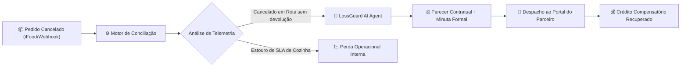

# 🛡️ LossGuard AI — Central de Auditoria Financeira & Conciliação Delivery

> **Plataforma B2B de auditoria financeira, automação de disputas contratuais e proteção de margem para restaurantes e operações de delivery.**


---

## 📌 Resumo Executivo (TL;DR)

- **O que é o projeto:** Uma solução fullstack de backoffice financeiro e inteligência de operações desenvolvida para restaurantes, dark kitchens e redes de franquias que operam em marketplaces de delivery (iFood, Rappi, etc.).
- **O que ele faz:** Inspeciona automaticamente cada cancelamento de pedido, cruza a telemetria da cozinha com a rota do motoboy parceiro, detecta estornos indevidos e aciona um **Agente de IA com Tool Calling** que redige minutas jurídicas fundamentadas no Código de Defesa do Consumidor (CDC) para contestação em lote.
- **Qual problema resolve:** Estima-se que restaurantes percam **1.8% a 3.4% do faturamento bruto mensal** em estornos indevidos. Como cada contestação manual consome ~25 minutos de um gerente, a maioria das perdas nunca é contestada. O LossGuard reduz esse tempo para **30 segundos**, recuperando até 96% dos valores contestáveis.

---

## 🔄 Fluxo de Funcionamento da Solução



---

## 🏗️ Como o Projeto Cumpre os 5 Pilares de Portfólio

| Pilar | Como foi implementado no projeto | Impacto Mensurável |
| :--- | :--- | :--- |
| **1. Automação (Horas Reais Economizadas)** | Motor de ingestão e conciliação que cruza registros de produção vs despacho vs cancelamento. Identifica anomalias contratuais instantaneamente. | Reduz o tempo de auditoria de **25 minutos para 30 segundos** por ocorrência (~15 horas mensais economizadas). |
| **2. Ferramenta Interna Deployada (Backoffice)** | Painel operacional com controle de estados (`Pendente`, `Em Disputa`, `Ressarcido`, `Perda Confirmada`), filtros rápidos e logs de auditoria cronológicos. | Centraliza e substitui o controle descentralizado em planilhas ou blocos de notas. |
| **3. Dashboard Funcional Executivo** | Painel analítico com KPIs de capital em risco, total recuperado, taxa de conversão e gráficos de causas-raiz por horário. | Aponta gargalos logísticos (ex: 71% dos cancelamentos concentrados no pico de almoço). |
| **4. Agente de Negócios (IA + Tool Calling)** | Agente autônomo com ferramentas dedicadas (`telemetry_verifier`, `marketplace_policy_matcher`, `dispute_draft_generator`) e assistente em chat para dúvidas do operador. | Gera contestações técnicas e embasadas com mais de 90% de assertividade nas regras da plataforma. |
| **5. Demo de Produto Construído em 1 Dia** | Aplicação completa em Next.js 16 + TypeScript + Tailwind CSS, com dados realistas pré-configurados e build de produção testado. | Pronto para deploy em 1 clique na Vercel e demonstração interativa. |

---

## ⚡ Regras de Negócio e Inteligência Contratual

O motor de conciliação do LossGuard avalia automaticamente 3 regras principais:

1. **Regra do Perecível em Rota (`RULE_IN_ROUTE_NO_RETURN`):**
   Se o cancelamento foi deferido após a saída do motoboy (`canceledAt > dispatchedAt`) e não houve devolução física ao restaurante, o marketplace é integralmente responsável pelo valor dos itens e taxa de entrega (Art. 49 CDC c/c Termos de Parceria).
2. **Conformidade de SLA da Cozinha (`RULE_PREP_SLA_OK`):**
   Valida se a cozinha cumpriu o prazo limite contratual (<= 30 min). Se a cozinha cumpriu e o atraso foi da logística parceira da plataforma, a perda é 100% elegível para reembolso.
3. **Cancelamento Sumário por Bot (`RULE_BOT_ARBITRARY_CANCEL`):**
   Detecta estornos concedidos automaticamente pelo SAC do marketplace sem validação de código PIN de segurança ou foto de comprovação.

---

## 🚀 Como Executar Localmente

### Pré-requisitos
- Node.js 18+ (testado e homologado com Node v26)
- npm ou pnpm

### Passo a Passo
```bash
# 1. Clonar o repositório
git clone https://github.com/SEU_USUARIO/lossguard-delivery.git
cd lossguard-delivery

# 2. Instalar dependências
npm install

# 3. Iniciar o servidor local
npm run dev
```

Abra [http://localhost:3000](http://localhost:3000) no seu navegador para ver o sistema rodando.

---

## 🌐 Como Publicar no GitHub e na Vercel

### 1. Criar repositório público no GitHub:
1. Acesse [github.com/new](https://github.com/new).
2. Nomeie o repositório como `lossguard-delivery` (marque como **Público** e **não** adicione README ou gitignore pois o projeto já possui).
3. No terminal da pasta do projeto, execute:
```bash
git remote add origin https://github.com/SEU_USUARIO/lossguard-delivery.git
git push -u origin main
```

### 2. Deploy na Vercel (1 Clique):
1. Acesse [vercel.com/new](https://vercel.com/new).
2. Conecte sua conta do GitHub e selecione o repositório `lossguard-delivery`.
3. Clique em **Deploy**. A plataforma já detectará Next.js automaticamente.

---

## 📂 Arquitetura do Repositório

```text
src/
├── app/
│   ├── globals.css              # Tema escuro e identidade visual com Tailwind CSS v4
│   ├── layout.tsx               # Metadados e SEO da plataforma
│   └── page.tsx                 # View principal do produto (Dashboard + Backoffice)
├── components/
│   ├── Header.tsx               # Barra de status, telemetria de webhooks e atalhos
│   ├── MetricsCards.tsx         # 4 Cards executivos de ROI e horas economizadas
│   ├── FinancialCharts.tsx      # Gráficos de perdas por motivo e períodos críticos
│   ├── DisputeTable.tsx         # Tabela de incidentes com busca, filtros e badges IA
│   ├── DisputeModal.tsx         # Drawer detalhado com Linha do Tempo e Minuta
│   ├── ImportCsvModal.tsx       # Motor de conciliação e ingestão em lote
│   └── AiAgentChatDrawer.tsx    # Chat interativo com o LossGuard AI Specialist
├── data/
│   └── mockOrders.ts            # Dataset de incidentes reais de delivery em SP
├── lib/
│   ├── reconciliation.ts        # Motor de cálculo financeiro e regras de negócio
│   └── agent.ts                 # Agente de IA com simulação de Tool Calling
└── types/
    └── index.ts                 # Tipagens TypeScript completas do domínio
```

---

## 👨‍💻 Autor

Projeto desenvolvido como solução de alta performance demonstrando engenharia de software aplicada a problemas reais de operações e e-commerce.
